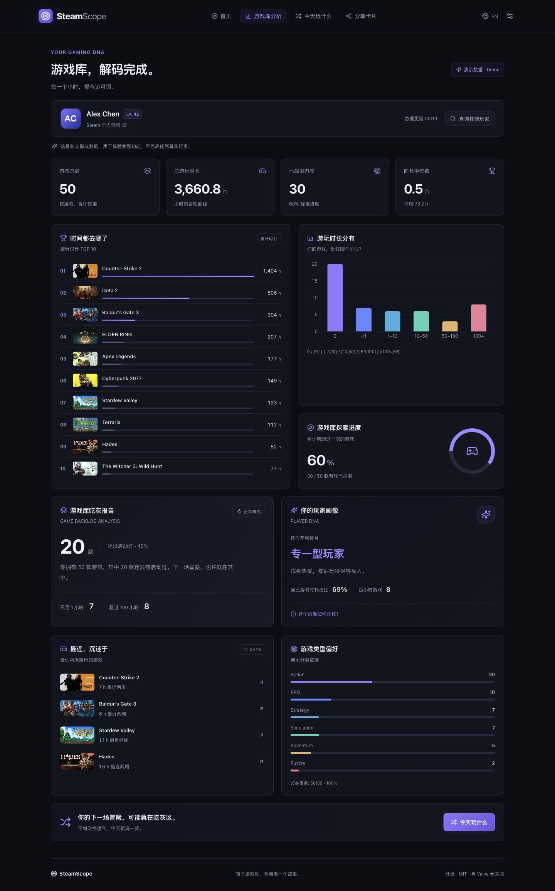
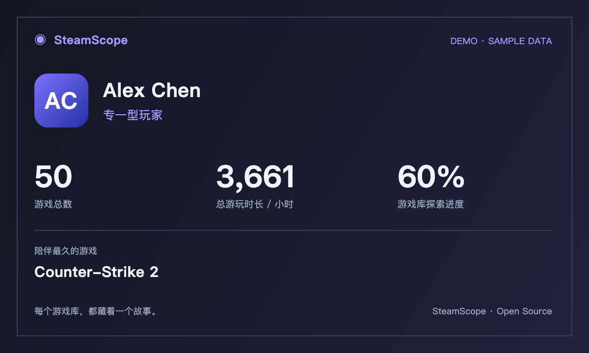

<div align="center">

# ◉ SteamScope

**你的游戏库，不止一个数字。**

Steam 游戏库分析、吃灰报告、玩家画像与随机游戏推荐。无需登录，不需要数据库。

[English](README.en.md) · [MIT License](LICENSE) · [数据与接口说明](docs/DATA.md)

[](https://github.com/Jamyouny/SteamScope/actions/workflows/ci.yml)
[](LICENSE)

</div>



## 功能

- **玩家查询**：SteamID64、`/profiles/` 和 `/id/` 个人资料链接；官方 API 解析自定义链接。
- **查询引导**：首页可展开查看浏览器/Steam 客户端复制资料链接、查找其他玩家和 SteamID64 格式说明。
- **真实统计**：游戏总数、游玩与未玩数量、累计/平均/中位时长、TOP 10 和最近两周记录。
- **可视化**：时长分布、排行榜、探索进度；可获取分类时显示商店元数据覆盖率。
- **吃灰报告**：正常与毒舌两种文案，统计全部由游戏库计算。
- **玩家画像**：收藏家、专一型、硬核、探索型、休闲及兜底画像，规则透明且可展开查看。
- **今天玩什么**：从未玩过、不足两小时、全部和自定义范围；随机抽取与老虎机动画。
- **分享卡片**：Dark / Cyberpunk / Minimal，含头像，1200×720 PNG 下载与图片复制。
- **偏好**：中英文、深浅主题、动画开关；仅偏好写入 localStorage，尊重系统减弱动态效果设置。
- **Demo**：独立的 50 款模拟游戏，持续显示演示标记；真实查询错误**不会**回退到模拟数据。

## 截图

截图存放在 [`docs/screenshots/`](docs/screenshots/)，均使用明确标注的 Demo 数据。

- `home.png`：首页
- `dashboard.png`：分析报告
- `mobile.png`：移动端
- `share-card-dark.png` / `share-card-cyberpunk.png` / `share-card-minimal.png`：实际下载的分享 PNG



## 技术栈

React 19 · TypeScript · Vite · Tailwind CSS 4 · Framer Motion · Recharts · Lucide React · Node.js · Vercel Serverless Functions · Vitest · ESLint · Prettier

## 本地启动

需要 **Node.js 22 或更高版本**和 npm。

```bash
git clone https://github.com/Jamyouny/SteamScope.git
cd SteamScope
npm install
cp .env.example .env.local
npm run dev
```

打开终端显示的地址，默认 `http://127.0.0.1:5173`。没有 API Key 时点击「先体验 Demo」即可使用所有分析、推荐和分享功能。

开发服务器内置服务端 API 中间件，因此 `npm run dev` 同时支持真实查询，无需另开后端。它使用与 Vercel 函数相同的处理逻辑。

```bash
npm run typecheck
npm run lint
npm test
npm run build
npm run format:check
```

`npm run preview` 仅预览构建后的静态前端，**不承载 API**；真实 API 请使用 `npm run dev`、`npx vercel dev` 或 Vercel 部署。

## Steam API Key

1. 前往 [Steam Web API Key](https://steamcommunity.com/dev/apikey)，按 Steam 的要求申请密钥。
2. 在项目根目录 `.env.local` 中设置：

```dotenv
STEAM_API_KEY=your_steam_api_key
```

3. 重启开发服务器。

只允许服务端读取 `STEAM_API_KEY`。**不要**添加 `VITE_` 前缀、写到前端、提交密钥或在 issue 中粘贴。`.env*` 默认忽略，仅 `.env.example` 允许提交。

查阅官方文档：[ISteamUser](https://partner.steamgames.com/doc/webapi/ISteamUser) · [IPlayerService](https://partner.steamgames.com/doc/webapi/IPlayerService) · [API 使用条款](https://steamcommunity.com/dev/apiterms)

## 本地网络代理（可选）

如果系统代理能访问 Steam，而 Node.js 后端请求超时，可以在 `.env.local` 另外配置 HTTP CONNECT 代理：

```dotenv
STEAM_PROXY_URL=http://127.0.0.1:你的代理端口
```

填写实际代理地址后重启开发服务器。仅 SteamScope 服务端的 Steam API、商店分类与头像请求使用该代理，不修改系统代理。默认不启用代理；不配置时直接请求 Steam。不要把本机的 `127.0.0.1` 代理地址配置到 Vercel：它指向部署服务器自身。Vercel 通常无需设置此变量。代理地址可能包含凭证，因此仅放在服务端环境中。

## Vercel 部署

1. 将本项目文件夹作为 GitHub 仓库根目录提交，确保没有 `.env.local`、`node_modules` 等文件。
2. 在 Vercel 导入仓库，框架选 **Vite**。
3. 构建命令 `npm run build`，输出目录 `dist`；Node.js 版本选择 22 或更新版本。
4. 在项目环境变量中添加服务端 `STEAM_API_KEY`，按需为 Production / Preview / Development 设置。
5. 部署。`api/library.ts`、`api/metadata.ts` 与 `api/avatar.ts` 自动成为函数。
6. 添加或修改环境变量后重新部署，再用公开游戏库验证 `/api/library` 返回真实数据。

没有密钥也可以部署并体验 Demo。`vercel.json` 包含单页应用回退与函数运行时上限。

部署 CLI 方式：

```bash
npx vercel
npx vercel --prod
```

当前项目已完成本地真实 Steam 查询验证，公开仓库位于 [Jamyouny/SteamScope](https://github.com/Jamyouny/SteamScope)。Vercel 线上部署尚未执行；部署时需要在 Vercel 设置服务端环境变量。

## 项目结构

```text
api/                     # Vercel 函数入口
  library.ts             # 玩家与游戏库查询
  metadata.ts            # 有界的分类补充（每次 ≤3 个游戏）
  avatar.ts              # 分享头像代理，仅允许 Steam CDN
server/                  # 服务端 Steam 客户端、缓存、超时与安全错误
shared/
  types.ts               # 前后端共享类型
  input.ts               # Steam 输入识别与验证
  analysis.ts            # 纯统计、画像和筛选逻辑
src/
  components/            # Home / Dashboard / Discover / Share / Ui / ErrorBoundary
  data/demo.json         # 明确分离的模拟数据
  lib/                   # 浏览器请求、偏好与 Canvas 分享卡片
  App.tsx                # 导航和状态协调
  styles.css             # 主题、布局与响应式样式
public/                  # 图标和示例头像
tests/                  # 统计边界、输入、服务端错误与缓存测试
docs/                   # 数据来源、验证记录与截图
.github/workflows/ci.yml  # 安装、类型、Lint、测试、构建与格式检查
```

## 数据口径与限制

统计基于 `GetOwnedGames` 实际返回的可读取游戏，分钟换算为小时；排行榜按累计时间排序，最喜欢的游戏以“游玩时长最长”代称。Demo 分类也是模拟数据。

时长分段互不重叠：`0`、`(0,1)`、`[1,10)`、`[10,50)`、`[50,100]`、`>100` 小时。平均和中位数包含零时长游戏；吃灰报告的“不足 1 小时”不包含零时长。

Steam 的 API 不保证返回账号所有授权产品。免费游戏只有已游玩时通过 `include_played_free_games` 加入；不可读取或 API 未返回的条目不纳入统计。零分钟代表 **Steam 记录为零**，不等同于绝对证明从未启动（离线时间、隐私或 API 记录差异可能影响结果）。

游戏类型来自 Steam 商店公开 JSON 元数据接口，属于补充来源，**并非有稳定性承诺的官方 Web API**。点击按钮按游戏库返回顺序最多补充 60 款；覆盖至少 60%，且至少 10 款有分类（小库需全部）才展示。多类型游戏计入多个类别，合计可能超过 100%；显示的是有分类子集，不能冒充完整游戏库结论。失败或不足覆盖时显示说明，不编造结果。

服务端游戏库缓存 5 分钟（最多 200 个玩家），分类缓存 24 小时（最多 1000 款），浏览器内存缓存 5 分钟（最多 20 次查询）。游戏库请求合并并发重复查询。Serverless 冷启动会清空这些内存缓存；不使用数据库，也不声称具备跨实例全局限流。服务端每个暖实例最多 80 次上游数据请求/分钟；大型公开部署建议另外配置 Vercel 平台限流。

Steam 头像代理只接受列出的官方 HTTPS CDN 与头像路径，拒绝重定向，限制 2MB，并设置超时；避免跨域 Canvas 污染导致导出失败。默认或 Cloudflare 头像节点失败时，在同一 12 秒期限内仅重试一次官方 Akamai 节点，保持相同头像哈希路径。头像仍无法取得时明确报告分享生成失败，保持真实数据。

## 常见问题

**查询显示未配置？**
检查服务端 `STEAM_API_KEY` 是否设置，修改后重启或重新部署。浏览器不需要也不应拿到密钥。

**资料是公开的，但查不到游戏？**
在 Steam「编辑个人资料 → 隐私设置」将「游戏详情」设为公开，并取消「始终对总游戏时间保密」。个人资料公开并不等于游戏详情公开。

**为什么没有类型偏好？**
Web API 不提供分类，需要手动补充元数据；没有足够覆盖率时本项目不会生成结论。Steam 商店不可用时仍可使用其他分析功能。

**最近游玩或等级不可用？**
这些是独立的可选接口。失败时保留成功获取的游戏库，并明确提示字段不可用。

**为什么复制图片失败？**
需要 HTTPS（或 localhost）、支持 `ClipboardItem` 的浏览器及权限。可直接下载 PNG。

**数据是否上传或保存？**
查询输入由本站服务端发送到 Steam；游戏库只在浏览器和服务端内存短期缓存。语言、主题、动画和毒舌偏好保存在本机 localStorage。没有用户账号、数据库或统计追踪。

**可以直接放 GitHub Pages 吗？**
可展示 Demo 静态页面，但真实查询需要服务端函数，推荐使用 Vercel。自定义子路径部署需要调整 Vite `base` 和静态资源路径。

## 开源与贡献

采用 [MIT License](LICENSE)。欢迎通过 issue 和 PR 贡献；提交前运行类型检查、Lint、测试和构建，勿附带任何密钥或私密玩家数据。具体方式见 [CONTRIBUTING.md](CONTRIBUTING.md)。

Steam、游戏名称、头像和游戏封面属于 Valve 或相应权利人，图片不随本项目代码获得 MIT 授权。本项目与 Valve 无关联。公开上线请遵守 Steam API 条款。
